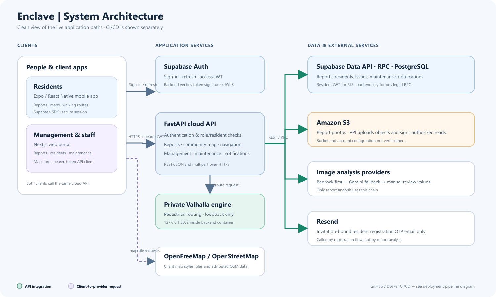
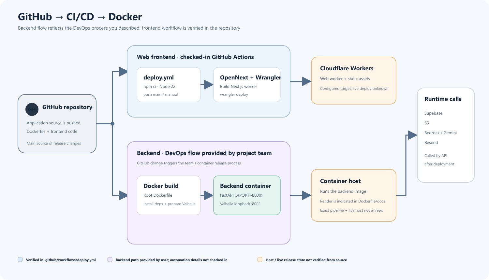
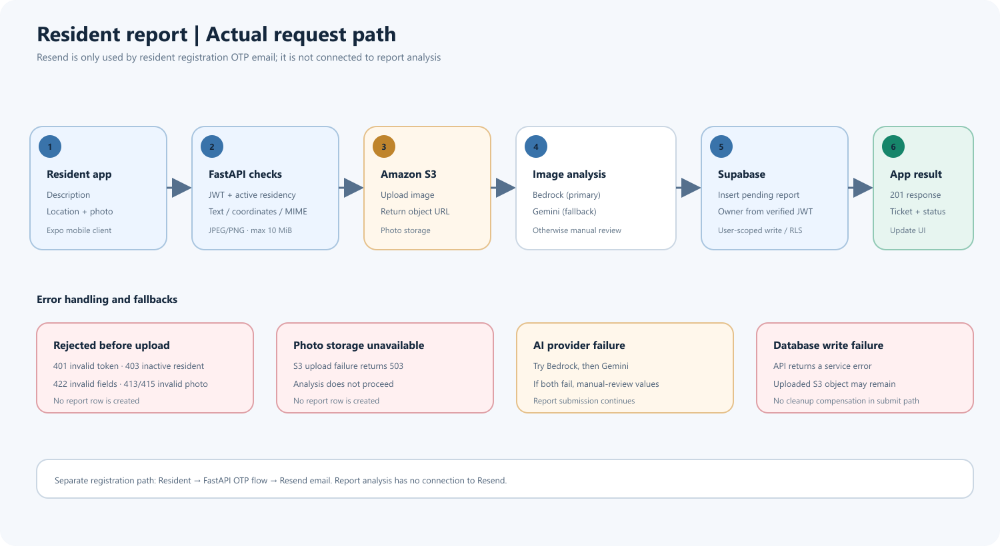
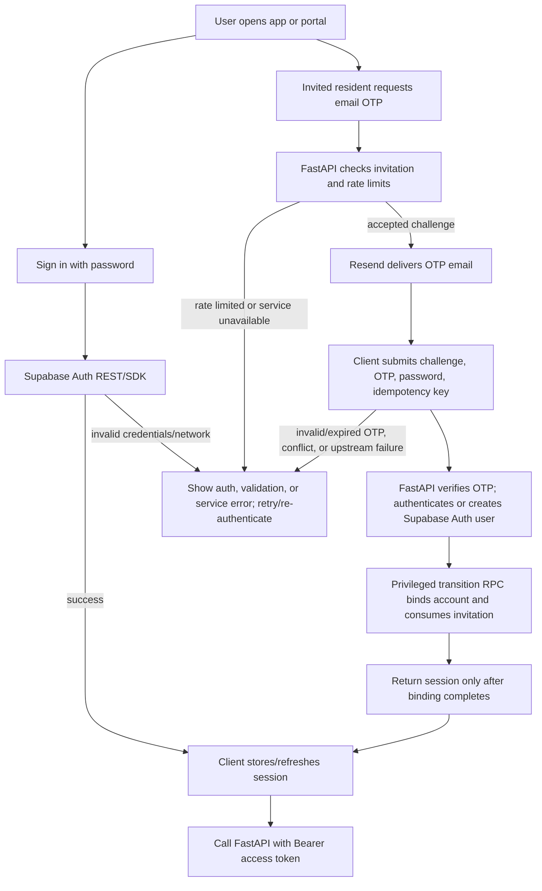

# Enclave System Architecture

> **Scope and evidence rule:** This document describes what is implemented in this repository and what its checked-in configuration would do. A configuration file is evidence of a deployment path, not proof that a remote service is currently deployed or healthy. Components marked **not verified** require access to the relevant provider account or live environment.

## 1. Project Overview

Enclave is a resident community issue reporting and safety application with a web portal and a native mobile client. The repository contains:

- A Next.js web portal for management and maintenance workflows, served through an OpenNext Cloudflare Workers build/deploy pipeline.
- An Expo / React Native mobile app for residents, including reports, community map, notifications, and walking routes.
- A FastAPI cloud API that verifies Supabase Auth tokens, enforces resident or staff access, and coordinates Supabase, S3, AI, email, and routing services.
- A separate SQLite practice API in `backend/local/`. It is not mounted by the cloud API or included in the root Docker image.

The cloud API is the repository's integrated application backend. A legacy standalone report router and several demos/practice apps are present in source but are not mounted in `backend.app:create_app`.

## 2. Architecture Summary

The browser and mobile app obtain and refresh Supabase Auth sessions directly. The clients send the resulting bearer access token to FastAPI for protected features. FastAPI verifies Supabase JWTs, then uses the resident JWT for user-scoped Supabase Data API access and the server-only Supabase key for privileged RPC/Auth operations. Report photos are uploaded to S3; report analysis tries Amazon Bedrock, then Gemini, then returns a manual-review fallback. Registration sends email through Resend and uses Supabase Auth plus database RPCs to bind an invited resident. Walking directions use a Valhalla engine served on the backend container's loopback interface, plus server-side routing and issue/accessibility logic.

The web deployment workflow builds and deploys the Next.js app to Cloudflare Workers when `main` is pushed (or manually dispatched). The project DevOps flow, as supplied by the user, pushes source to GitHub and builds/runs the backend in Docker; the root Docker configuration contains the API and routing engine build. The repository identifies Render through the `PORT` convention and setup documentation, but does not contain the backend release workflow itself. The exact automation, image registry, and running host cannot be inspected here.

## 3. System Architecture Diagram

_Figure 1. How the system is currently connected. Green borders indicate integrations that have been implemented or configured within the repository; orange markers indicate that the actual deployment status cannot be verified from the repository._

**Evidence/status interpretation:** Client-to-API, Auth, Data API/RPC, Resend, S3, AI, routing, and map requests are established by source/configuration. Cloudflare Workers publishing is configured in `.github/workflows/deploy.yml` and `frontend/enclave-web/wrangler.jsonc`; whether it has run successfully is **not verified**. The worker asset binding is configured, but a separate CDN, WAF, DNS provider, custom-domain route, and TLS certificate configuration are **not verified**. Supabase is a hosted project URL and uses PostgreSQL behind its Data API; project region, database sizing, backup setup, and network policy are **not verified**.

## 4. Deployment Architecture

_Figure 2. Web deployment path derived from a submitted GitHub Actions workflow. The backend GitHub-to-Docker pipeline is mapped based on information provided by the project’s DevOps team; while the repository contains a `Dockerfile` and Compose configuration, no backend deployment workflow was found. Therefore, the specific automation steps, image registry, and production container platform remain subject to confirmation against the DevOps configuration._

### Web portal

`frontend/enclave-web/package.json` defines Next.js development/production scripts and `build:cloudflare` (`opennextjs-cloudflare build`). `frontend/enclave-web/open-next.config.ts` enables the OpenNext Cloudflare adapter. The Wrangler config points at `.open-next/worker.js`, binds generated static assets, and enables `nodejs_compat`. `.github/workflows/deploy.yml` installs with `npm ci`, builds with the three `NEXT_PUBLIC_*` values, checks those values are non-empty, and runs `npx wrangler deploy` using `CLOUDFLARE_API_TOKEN`. It triggers on pushes to `main` and manual dispatch. The checked-in example API base URL is `https://enclave-6085.onrender.com`; the actual configured secret value is not readable from the repository.

### Cloud API and routing engine

The root `Dockerfile` uses `python:3.12-slim-bookworm`, installs `requirements.txt`, copies the project, and runs `python -B -m backend.navigation.prepare` at image build time to prepare the pinned Linux routing runtime and bundled KL East road graph. The container command launches `uvicorn backend.navigation.container_app:app` on `${PORT:-8000}` with one worker. The container app starts a private Valhalla FastAPI engine on `127.0.0.1:8002` and gates API health on engine readiness. `docker-compose.yml` exposes host port 8000, injects root `.env`, and runs one backend service. The API's normal non-container entrypoint is `main:app` / `backend.app:app`; it does not start the private Valhalla child process, so live route requests require an available configured routing provider.

Root docs and the `PORT` runtime convention point to Render as the intended backend host, but no Render service manifest is checked in. Current hosting, service size, autoscaling, persistent disk, health-check settings, custom domain, and whether Docker Compose or Render is used in production are **not verified**.

### Mobile application

`frontend/enclave-mobile/app.json` configures the Expo app, native identifiers, runtime fingerprint versioning, and Expo Updates URL. `eas.json` defines development, preview, and production build profiles. No EAS build/submit workflow is checked in, so published store builds, release channels, and live update status are **not verified**. `EXPO_PUBLIC_API_URL`, `EXPO_PUBLIC_SUPABASE_URL`, and `EXPO_PUBLIC_SUPABASE_ANON_KEY` are client build-time configuration; they must not contain backend credentials.

### Secrets and environments

The backend loads the root `.env` plus explicit environment overrides through `backend/core/config.py`. `.dockerignore` excludes `.env` files and local runtimes from the image build context. The backend-only `SUPABASE_KEY`, optional legacy `SUPABASE_JWT_SECRET`, `RESEND_API_KEY`, AWS credentials, bucket name, and optional model/API configuration belong on the server. Browser/mobile Supabase publishable/anon keys and API URLs are public client configuration. The actual production secret store and values are **not verified**. No CI workflow for backend image publishing or database migrations is present.

## 5. Website and Application Flow

### Resident report submission (mobile; same API contract available to authenticated clients)

_Figure 3. Core repair request workflow, along with error paths for authentication, input, storage, and the database._

Code evidence: `frontend/enclave-mobile/src/screens/ReportScreen.tsx`, `src/lib/api.ts`, `backend/app.py` (`submit_report`), `backend/reports/media.py`, and `backend/reports/repository.py`. A database write failure after the S3 upload can leave an unreferenced object; no compensating delete is implemented in that request path.

### Sign-in and invited resident registration

Registration routes live in `backend/routers/email.py`; orchestration is in `backend/registration/service.py`. OTP/challenge state and transactional transitions are implemented through Supabase RPCs and SQL files, while email delivery is an in-process call to Resend. The repository's registration guide says delivery is not backed by a durable queue; a process restart can interrupt a pending send.

### Management and maintenance workflows

The web portal uses the same bearer-token API client. Management report review uses `/api/v1/management/reports` and `/api/v1/management/reports/{ticket_id}/status`; the workflow service writes status and history atomically through Supabase RPC and checks management role. Maintenance management assigns tasks and reviews work under `/api/v1/management/maintenance/*`; staff use `/api/v1/maintenance/*` to list tasks, start work, record progress/blockers, upload evidence, and read notices. Expected status/version values protect writes against stale screens. Report notes can be owner-visible. Backend routes and repositories are in `backend/maintenance/routes.py`, `backend/maintenance/repository.py`, and `backend/reports/moderation.py`.

The portal also contains management resident and invitation screens, notification broadcasts, and a read-only what-if repair comparison. The what-if service reads a snapshot and computes candidate paths; its API description explicitly says it does not save scenarios or mutate reports/issues. Some legacy report/demo workflow modules exist in source but are not the mounted cloud API.

## 6. Major Feature and Data Flows

| Feature                   | Client/API path                                                                            | Main backend work                                                                                              | Data/services                                                                                              |
| ------------------------- | ------------------------------------------------------------------------------------------ | -------------------------------------------------------------------------------------------------------------- | ---------------------------------------------------------------------------------------------------------- |
| Sign-in and token refresh | Web `src/lib/auth-session.ts`; mobile `src/lib/supabase.ts`                                | Supabase validates credentials; FastAPI separately verifies access JWT/JWKS                                    | Supabase Auth                                                                                              |
| Resident registration     | `POST /api/v1/registration/request-otp`, `POST /api/v1/registration/verify-and-signup`     | Invitation lookup, rate limits, OTP HMAC digest, account login/create, transactional bind                      | Resend, Supabase Auth Admin, Supabase RPC/PostgreSQL                                                       |
| Private report            | `POST /api/v1/reports`; `GET /api/v1/reports`, `/{ticket_id}`                              | Active-residency check, upload, AI analysis, owner-scoped persistence and reads                                | S3, Bedrock, Gemini fallback, Supabase Data API                                                            |
| Community issue/map       | `/api/v1/facilities`, `/api/v1/community/issues`, `/api/v1/map/issues`                     | Explicit facility/incident linking; one resident counts once; map threshold is two distinct verified residents | Supabase RPC/Data API; no private evidence/identities in map output                                        |
| Walking navigation        | `GET /api/v1/navigation/area`; `POST /api/v1/navigation/routes`; area/demo/place endpoints | Area checks, Valhalla provider, community obstacle avoidance and optional verified access network              | Bundled OSM-derived road graph; loopback Valhalla; Supabase issue snapshot; bundled/database place catalog |
| Management report review  | `/api/v1/management/reports`, status PATCH, report history                                 | Management-role check, atomic status/history transitions, photo link signing                                   | Supabase RPC/Data API, S3 presigned links                                                                  |
| Maintenance               | `/api/v1/management/maintenance/*`, `/api/v1/maintenance/*`                                | Assignment, staff authorization, optimistic version checks, evidence/photo workflow and history                | Supabase RPC/Data API; SQL 017 supports schema/workflow                                                    |
| Notifications             | `/api/v1/management/notifications`, `/api/v1/notifications*`                               | Management broadcast and resident-owned read status                                                            | Supabase Data API/RPC                                                                                      |
| What-if planning          | `/api/v1/management/what-if/candidates`, `/compare`                                        | Read-only issue snapshot and route comparisons                                                                 | Supabase snapshot RPC, navigation service                                                                  |

Community issue visibility is deliberately separate from private report ownership and management approval. The public-to-residents map projection exposes a community issue only after two distinct verified residents link evidence to the same open facility incident. Navigation avoidance uses confirmed community obstacles for applicable route modes. The code marks pilot/OSM coverage as not field verified and labels service rectangles as not official boundaries.

## 7. Technology Stack and Services

| Layer                   | Technology / Service                    | Actual Role in This Project                                                                                                                      | Evidence / Configuration                                                  | Status                                                                     |
| ----------------------- | --------------------------------------- | ------------------------------------------------------------------------------------------------------------------------------------------------ | ------------------------------------------------------------------------- | -------------------------------------------------------------------------- |
| Web frontend            | Next.js 16, React 19, TypeScript        | Management and maintenance portal, App Router pages and client components                                                                        | `frontend/enclave-web/package.json`, `src/app/`, `src/components/`        | Confirmed in source                                                        |
| Web runtime/deploy      | OpenNext, Wrangler, Cloudflare Workers  | Adapts and deploys the Next app and generated assets                                                                                             | `open-next.config.ts`, `wrangler.jsonc`, `deploy.yml`                     | Configured; live status not verified                                       |
| Mobile frontend         | Expo 57, React Native 0.86, TypeScript  | Native resident application                                                                                                                      | `frontend/enclave-mobile/package.json`, `App.tsx`, `src/`                 | Confirmed in source                                                        |
| Mobile maps             | MapLibre React Native                   | Native maps and route/map rendering                                                                                                              | mobile package, `src/screens/`, `src/navigation/`                         | Confirmed in source                                                        |
| Web maps                | MapLibre GL JS                          | Management report and route map views                                                                                                            | web package and `src/components/management/*Map*`                         | Confirmed in source                                                        |
| API framework           | Python 3.12, FastAPI, Uvicorn, Pydantic | Cloud REST API, validation, OpenAPI, lifecycle                                                                                                   | `requirements.txt`, `backend/app.py`, `Dockerfile`                        | Confirmed in source                                                        |
| Identity                | Supabase Auth                           | Password sign-in, refresh, account provisioning, user JWT/JWKS                                                                                   | Web/mobile auth clients; `backend/core/auth.py`; registration clients     | Integrated; production project not verified                                |
| Database/API            | Supabase Data API, RPC, PostgreSQL      | Report, resident, issue, notification, maintenance and workflow persistence                                                                      | `backend/*/repository.py`, `backend/sql/`, API contract                   | Integrated; hosted schema state partly unverified                          |
| Photo storage           | Amazon S3 via boto3                     | Stores report photos, returns short-lived signed read links, cleanup during resident deletion                                                    | `backend/reports/media.py`, root `.env.example`                           | Optional runtime credentials; bucket/account not verified                  |
| Primary image analysis  | Amazon Bedrock Runtime                  | Analyzes uploaded report image and text                                                                                                          | `backend/reports/media.py`; defaults to `amazon.nova-lite-v1:0`           | Configurable; live access not verified                                     |
| Fallback image analysis | Google Gemini API                       | Fallback after Bedrock fails                                                                                                                     | `backend/reports/media.py`, `GEMINI_API_KEY`                              | Optional; live access not verified                                         |
| Registration email      | Resend                                  | Delivers invitation-bound OTP messages                                                                                                           | `backend/registration/settings.py`, `backend/services/email_service.py`   | Integrated; account/domain delivery not verified                           |
| Routing                 | Valhalla                                | Pedestrian route calculation, privately served on loopback in Docker                                                                             | `backend/navigation/engine.py`, `container_app.py`, `Dockerfile`          | Docker build path configured; running deployment not verified              |
| Map/road data           | OpenStreetMap, OpenFreeMap              | Bundled OSM-derived pilot routing snapshot; external map styles/tiles and attribution                                                            | `backend/navigation/data/`, navigation contracts, frontend map components | Confirmed integration; coverage/availability not verified                  |
| Alternate map tiles     | OpenStreetMap raster tiles              | Used by management what-if map                                                                                                                   | `WhatIfPathMap.tsx`                                                       | Confirmed code path                                                        |
| Mobile updates          | Expo Updates / EAS configuration        | Runtime update URL and build channels/profiles                                                                                                   | `app.json`, `eas.json`                                                    | Configured; published builds/status not verified                           |
| Local practice backend  | SQLite, separate FastAPI app            | Local workflow practice only; not used by cloud app                                                                                              | `backend/local/`, separate requirements and README                        | Confirmed separate implementation                                          |
| CI/CD                   | GitHub Actions                          | Web build and Cloudflare Workers deployment                                                                                                      | `.github/workflows/deploy.yml`                                            | Workflow configured; run history not verified                              |
| Backend release flow    | GitHub → Docker container               | Project DevOps team reports that source is pushed to GitHub and deployed in Docker; repository has the Docker build but not its release workflow | User-provided DevOps description; `Dockerfile`, `docker-compose.yml`      | Project-confirmed flow; automation/registry/host details not in repository |
| Containerization        | Docker                                  | Backend plus local routing engine image                                                                                                          | Root `Dockerfile`, `docker-compose.yml`                                   | Configured; production use not verified                                    |

## 8. API and Data Flow Summary

All protected API calls use `Authorization: Bearer <Supabase access token>`. FastAPI verifies JWT signatures against the project's public JWKS (and optionally supports legacy HS256 with `SUPABASE_JWT_SECRET`). The application passes the end-user JWT to user-scoped Supabase Data API calls so database RLS can apply. Privileged registration and management operations use the backend-only key and controlled RPC/Auth Admin calls. FastAPI CORS allows `https://enclavehomes.app`, `http://localhost:3000`, and `http://127.0.0.1:3000`; the mobile native client is not governed by browser CORS.

| Method and endpoint                                                                                                                | Caller / purpose                                      | Authorization and principal data path                                                                               |
| ---------------------------------------------------------------------------------------------------------------------------------- | ----------------------------------------------------- | ------------------------------------------------------------------------------------------------------------------- |
| `GET /health`, `GET /`                                                                                                             | Container/orchestrator health and API greeting        | Health is gated on private routing engine only in `container_app`; basic app health route otherwise                 |
| `GET /auth/me`, `GET /api/v1/me/residency`                                                                                         | Web/mobile session and resident binding check         | Valid Supabase JWT; residency lookup is user scoped                                                                 |
| `POST /api/v1/registration/request-otp`, `POST /api/v1/registration/verify-and-signup`                                             | Resident onboarding                                   | Public request is rate limited and invitation-bound; verify uses idempotency key, RPC, Supabase Auth, Resend        |
| `POST /api/v1/reports`, `GET /api/v1/reports`, `GET /api/v1/reports/{ticket_id}`                                                   | Resident report submission and private reads          | Active verified resident; report owner derived from JWT; image in S3, rows in Supabase                              |
| `GET /api/v1/management/reports`, `PATCH /api/v1/management/reports/{ticket_id}/status`, `GET /api/v1/reports/{ticket_id}/history` | Review and audit history                              | Management role or report owner/active resident according to route; status/history RPC                              |
| `/api/v1/facilities`, `/api/v1/community/issues`, `/api/v1/map/issues`, `/api/v1/navigation/obstacles`                             | Community map and issue evidence                      | Active verified resident; bounding-box/pagination filters; thresholded map projection                               |
| `/api/v1/navigation/area`, `/api/v1/navigation/routes`, `/api/v1/navigation/areas/*`                                               | Resident routing, places and demo data                | Active verified resident; API validates area/route bounds and modes; routes use routing provider and issue snapshot |
| `/api/v1/management/what-if/*`                                                                                                     | Repair scenario comparison                            | Management role; read-only snapshot and route calculation                                                           |
| `/api/v1/maintenance/*`, `/api/v1/management/maintenance/*`                                                                        | Staff task execution and management assignment/review | Role checks in `backend/maintenance/routes.py`; versioned writes and evidence upload                                |
| `/api/v1/notifications*`, `/api/v1/management/notifications`                                                                       | Resident notices and management broadcasts            | Active verified resident for reads/read state; management role for broadcast                                        |

Typical success responses are JSON Pydantic models; report/task evidence and report creation use `multipart/form-data`. Errors use HTTP status plus FastAPI `detail` messages. Clients parse JSON errors, surface validation/provider failures, and use request timeouts (the mobile client defaults to 60 seconds; report uploads may take longer). The API returns `401` for missing/invalid tokens, `403` for role/residency denial, `409` for stale/conflicting transitions, `413` for oversized report photos, `415` for unsupported report photo MIME types, and `503` for unavailable dependencies where defined. No WebSocket endpoint, durable background worker, or scheduled job is mounted in the cloud app. OTP delivery is performed in-process.

## 9. Security and Infrastructure Considerations

- The frontend uses public Supabase publishable/anon keys. `SUPABASE_KEY` is a privileged backend-only key and `.dockerignore` excludes local env files.
- The API does not trust a submitted report owner ID; it derives ownership from the verified bearer token and explicitly rejects a `user_id` form field.
- Resident endpoints require an active verified residency binding. Management/staff capabilities have separate role checks. User-scoped Data API requests retain the user token for RLS and repository-level ownership filters.
- Report photo input is limited to JPEG/PNG and 10 MiB. API responses use signed S3 URLs for stored report photos after access checks; generated links last one hour.
- Registration OTP digests are HMAC-protected with a purpose-derived key, invitation-bound, rate-limited, and consumed through transactional RPC operations. Do not assume database migration SQL has been applied merely because scripts are checked in.
- Routing engine binds to loopback and is not exposed as a public route API in the Docker configuration. Route input and pilot-area constraints are validated by FastAPI and the engine.
- Domain-level DNS, WAF, public bucket policy, AWS IAM role assignment, Supabase network restrictions, database backups, production log retention, and incident monitoring are not verifiable from this repository.

## 10. Assumptions, Limitations, and Unverified Components

1. The repository proves checked-in implementation and deployment configuration only. No provider account inspection or live health check was available.
2. Cloudflare Workers deployment is configured for the web app; successful current deployment, account/zone ownership, DNS records, custom hostnames, CDN/WAF rules, and TLS settings are **not verified**.
3. Render is indicated by the backend `PORT` convention and API URL example/documentation. A Render service definition, current service status, environment settings, and actual production backend host are **not verified**.
4. Supabase Auth, PostgREST/Data API, RPC, and PostgreSQL are the cloud identity/data dependencies. Actual production project, applied SQL migration versions, RLS state, database region, backups, and operational settings are **not verified**. Repository documentation explicitly calls out staging validation still needed for some integrations/RLS.
5. S3, Bedrock, Gemini, and Resend clients are implemented and configured by environment variables, but configured account, successful credentials, current quotas, model availability, sender verification, and production use are **not verified**. AI analysis has a manual-review fallback; report photo upload still requires S3.
6. Docker builds a bundled Valhalla routing engine from repository OSM data. The engine runs in the same container as the API on loopback, not as a separately verified hosted microservice. Whether production uses this Docker image is **not verified**.
7. OpenFreeMap/OpenStreetMap styles/tiles and map attribution are in code. External service availability, rate limits, and production usage are **not verified**.
8. Expo app identifiers, update URL, EAS profiles, and native code exist; store publication, credentials, current installed version distribution, and live update deployment are **not verified**.
9. `backend/local/` is an independent SQLite practice application, while `backend/*demo.py`, `backend/navigation/engine.py`, and `backend/routers/reports.py` include standalone or historical paths. These should not be mistaken for additional deployed cloud services or mounted routers.
10. No mobile app-specific report/maintenance endpoints use WebSockets, and the cloud app contains no durable worker/scheduler implementation.

## 11. Relevant Repository File References

- Entrypoints and API: `main.py`, `backend/app.py`, `backend/maintenance/routes.py`, `backend/routers/email.py`
- Auth/configuration: `backend/core/auth.py`, `backend/core/config.py`, `.env.example`, `.dockerignore`
- Report upload, AI and persistence: `backend/reports/media.py`, `backend/reports/repository.py`, `backend/reports/models.py`
- Registration and email: `backend/registration/service.py`, `backend/registration/clients.py`, `backend/registration/settings.py`, `backend/services/email_service.py`
- Community and navigation: `backend/reports/issues.py`, `backend/navigation/service.py`, `backend/navigation/provider.py`, `backend/navigation/container_app.py`, `backend/navigation/engine.py`, `backend/navigation/data/README.md`
- Maintenance, notifications and what-if: `backend/maintenance/`, `backend/notifications/`, `backend/what_if/`
- Database schema/operations: `backend/sql/`, `backend/docs/api/API_CONTRACT.md`, `backend/docs/registration/REGISTRATION_HANDOFF.md`
- Web: `frontend/enclave-web/package.json`, `frontend/enclave-web/src/app/`, `frontend/enclave-web/src/lib/api.ts`, `frontend/enclave-web/src/lib/auth-session.ts`, `frontend/enclave-web/open-next.config.ts`, `frontend/enclave-web/wrangler.jsonc`
- Mobile: `frontend/enclave-mobile/package.json`, `frontend/enclave-mobile/app.json`, `frontend/enclave-mobile/eas.json`, `frontend/enclave-mobile/src/lib/api.ts`, `frontend/enclave-mobile/src/lib/supabase.ts`
- Deployment: `Dockerfile`, `docker-compose.yml`, `.github/workflows/deploy.yml`
