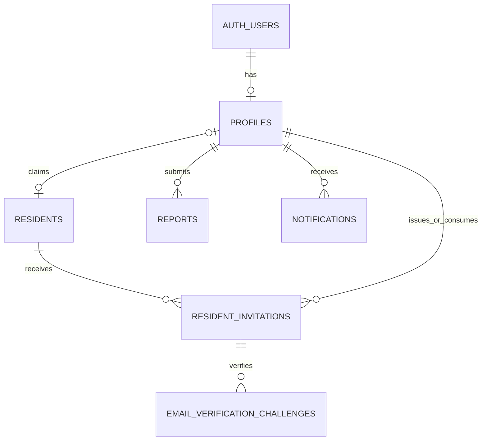

# Single-community resident registration

Status: implemented in cloud API v0.4.0. The user applied the three-table DDL and profile-access SQL on 2026-10-14; the subsequent metadata snapshot matches the intended tables, constraints, grants, and policies. SQL 005 is reported applied on 2026-10-15, and a no-mutation probe confirms anonymous RPC denial. Mock API/provider tests and dedicated PostgreSQL transaction/RLS tests pass. Live delivery/Auth integration remains unverified. See [REGISTRATION_HANDOFF.md](REGISTRATION_HANDOFF.md) for prepared private settings and management setup, and [REGISTRATION_TESTING.md](REGISTRATION_TESTING.md) for local practice. This is the current design for Enclave's first community and supersedes the earlier six-table alternative in `RESIDENT_VERIFICATION_DESIGN.md`. Do not apply both drafts.

## Existing schema and scope

The initial Schema Visualizer and metadata show `profiles`, `reports`, `notifications`, and `categories`. The post-application snapshot additionally confirms the three registration tables and restricted profile access. `profiles.id` remains a UUID primary key referencing `auth.users.id`; no Auth-to-profile trigger is present. Report/notification/category policies remain absent in the supplied metadata. See [REGISTRATION_SCHEMA_REVIEW.md](REGISTRATION_SCHEMA_REVIEW.md) for the findings and rollout order.

Reuse `profiles` for account details. Add three application tables for resident registration. No additional `communities`, `community_staff`, or `resident_memberships` table is required for this single-community MVP. Reports, notifications, categories, and their existing foreign keys are outside this change.

The [read-only schema inspection](sql/inspect_registration_schema.sql) was supplied and reviewed on 2026-10-14. Rerun it after applying reviewed SQL or if the schema changes. It returns metadata, not resident rows, passwords, tokens, or trigger function bodies. The CREATE TABLE draft remains deliberately strict about name conflicts; stop and inspect if another teammate has since created the tables.

The already-applied [three-table DDL](sql/003_single_community_registration_draft.sql) matches the supplied profile key structure. The separate [profile access SQL](sql/004_profile_registration_access.sql) gives users own-profile reads and updates limited to full_name. The new [SQL 005](sql/005_registration_transitions.sql) adds a shared private rate table and service-role-only transaction RPC. FastAPI orchestrates that RPC, Resend, and Supabase Auth; do not rerun 003 when adding 005.

## Table design

| Table | Responsibility | Key rules |
| --- | --- | --- |
| `auth.users` (existing, managed) | Account UUID, email/password authentication, confirmed email, sessions | Supabase Auth owns this table. Use Auth APIs, not direct SQL writes. |
| `profiles` (existing) | Account-facing email, display name, trusted role | Keep `id = auth.users.id`; roles are resident/management. Backend provisions missing profiles and clients may edit only full_name. |
| `residents` (new) | Management's approved register: resident reference, legal/registered name, unit, approved individual email, active status | `profile_id` is nullable before signup and unique once bound. Reference and normalized email are unique; unit number is not unique. |
| `resident_invitations` (new) | Email-bound invitation for one resident | Store a high-entropy token's digest, issuer, expiry, revocation, and consuming profile. One open invitation per resident. |
| `email_verification_challenges` (new) | Six-digit OTP verification plus signup recovery | Store the OTP HMAC digest, expiry, failed attempts, delivery acceptance, verification, and account-provisioning progress. Backend-only access. |
| `registration_rate_limits` (SQL 005 infrastructure) | Shared request and verification counters | HMAC IP/email subjects, fixed time buckets, backend-only access. Not another resident identity table. |

The last three relationships have distinct SQL foreign keys; the diagram combines issuer and consumer relationships for readability. The metadata snapshot confirms the existing report/notification links; the DDL proposes the new resident and invitation links.

Management creates each person's resident row before signup, with `profile_id` and `verified_at` both null. A family of three can have three resident rows with the same unit number and different approved emails. After signup, the successful account UUID is written to that resident's `profile_id` and `verified_at` is recorded in the same transaction.

`residents.full_name` is management's authoritative roster name. `profiles.full_name` is account display data. `registered_email` is the approved signup target; keep it aligned with Auth email through a reviewed email-change procedure. Do not automatically change eligibility when a user edits profile fields.

## OTP storage

Generate the OTP as a string, for example `f"{secrets.randbelow(1_000_000):06d}"`, so `003482` remains six digits. Resend receives the plaintext only when the backend sends the email. Do not store or log the plaintext code.

Store a 32-byte `otp_digest` produced by HMAC-SHA256 with a server-held secret. Bind the calculation to deterministic context: challenge ID, resident ID, invitation ID, normalized email, purpose, and code. Store the secret version, not the secret. Compare candidates with `hmac.compare_digest`. Unkeyed SHA256 alone is inadequate for a six-digit code because its possible values can be enumerated.

Recommended MVP limits: five-minute OTP expiry, five failed checks per challenge, 60-second resend cooldown, and at most three sends per email per 15 minutes. Enforce additional failure limits across resends and by IP using a shared server-side limiter. New challenges must not reset those aggregate budgets. Provider acceptance is delivery-request acceptance, not proof that the resident received the message.

Invitation tokens should contain at least 32 random bytes; store only their SHA256 digest. The invitation is separate from the six-digit OTP. Issue it only after management approves the individual's email. An invitation demonstrates eligibility through the roster; the OTP demonstrates control of that email address.

## One signup action after the OTP

1. Management creates an active resident record and an email-bound invitation, initially expiring after seven days. Residents without an invitation contact management; approval results in a resident row and invitation using this same process.
2. The resident enters the invitation, email, and password. The frontend keeps the password only temporarily in memory; the request-OTP API receives the email and invitation, not the password. FastAPI validates the unused invitation and active, unbound resident, applies rate limits, creates a challenge, and calls Resend.
3. The resident enters the OTP. The frontend calls **one** `verify-and-signup` endpoint with the challenge ID, OTP string, password, and a high-entropy `Idempotency-Key`. Generate the key once for this submit action and reuse it on transport retries. No separate confirmation-token form or extra signup button is required.
4. A database transaction locks resident, invitation, and challenge in that order. Recheck the invitation target/expiry, approved roster email, resident status, challenge delivery acceptance/expiry, and attempt budget. A wrong code increments `attempt_count` and commits that increment. A correct code atomically records `verified_at`, the idempotency-key digest, and a ten-minute signup recovery window. A different key cannot claim an already verified challenge.
5. An atomic server-only transition obtains a short processing lease. Every worker write validates its lease token; expired workers must stop writing. Serialize external Auth work for this resident and reconcile uncertain results before another create request. Keep HTTP calls outside database transactions. The draft includes lease fields, but the RPCs/transactions and worker behavior still need implementation.
6. For a new account, a server-only Supabase Auth Admin call creates the user with the submitted password and `email_confirm=True` only after verification. Trusted `app_metadata` may record the challenge ID for recovery. An existing account must authenticate with its own password and have a matching confirmed Auth email before binding; never reset its password, overwrite its confirmation, or attach an account found by email alone.
7. Sign in through Supabase Auth, keep the resulting session in memory, and verify the authenticated UUID/email against the account provisioned for this challenge. Record `auth_user_id` for recovery. Signup must never accept a role, profile ID, or resident ID chosen by the client.
8. A final application transaction locks the same rows and validates the current processing lease and signup window. Recheck the resident and invitation. Insert a missing profile using the authenticated UUID, verified email, roster name, and the literal role `resident`. If a profile already exists, verify its identity/email and preserve its trusted role. Bind `residents.profile_id`, set `verified_at`, mark the invitation used by that same profile, and mark the challenge completed. Profile creation and all these binding writes commit together. The invitation must still be valid at completion. No Auth trigger is assumed or added.
9. Return signup success and the **Supabase Auth session** only after the binding commits. Supabase issues the JWT; FastAPI verifies it on later API calls. The frontend can install the returned session through the Supabase SDK. The user is then signed in without another manual signup action.

Supabase account creation does not itself return a login session. The automatic password sign-in is a separate Auth API call within the same user action. A failed sign-in after registration can return an explicit registered-but-login-required result, or the same request can retry sign-in; do not recreate the account.

## Failure recovery and lifecycle

Supabase Auth calls and application SQL are separate systems. Multiple Data API requests are not one transaction. Implement each atomic transition through reviewed backend-only RPCs or actual PostgreSQL transactions, with EXECUTE restricted to the trusted backend.

- When Auth creates a user but application binding fails, preserve the attempt and reconcile its authenticated UUID. Retry the same attempt instead of creating another account or deleting the user. A matching idempotency key supports recovery within its window; issuing a JWT still requires successful Supabase password authentication.
- The challenge UUID and idempotency key are not login credentials. A consumed OTP cannot verify a new signup. Completed retries may authenticate the already bound account and return a fresh session; they cannot create another binding. Do not persist JWTs or refresh tokens in these application tables.
- Pending submissions acquire a time-limited processing lease. A retry with a live lease returns an in-progress result. Lease expiry permits recovery, not a blind second account creation. Stop stale workers through token checks. A crashed attempt with uncertain Auth state needs reconciliation before revocation or replacement.
- Resending revokes an unverified, unfinished challenge and creates a new code. It never clears attempts on the same row. Expired invites are explicitly revoked before replacement. Verified/provisioning challenges must be reconciled before management replaces an invitation.
- Management must use stable resident references and prevent duplicate real-person roster entries. Database uniqueness prevents duplicate bindings to the same record; it cannot identify the same person entered under different references/emails.
- Deactivate a former resident by setting their roster status to `inactive` and revoking outstanding invitations/challenges. Keep the account binding for audit and recovery. Use normal password reset for a forgotten password. Account reassignment/deletion requires a separate reviewed procedure; new foreign keys deliberately restrict deleting referenced profiles/Auth users.
- For existing app accounts, management may link an approved roster entry after authenticated email verification. Do not auto-approve all existing accounts. Existing reports are retained, and their future residency eligibility requires an explicit decision.

## Proposed API contract

These routes are not implemented. Existing Swagger/OpenAPI continues to describe the running report/auth APIs.

| Route | Request | Response |
| --- | --- | --- |
| `POST /api/v1/registration/request-otp` | `email`, `invitation_token` | `202` with a generic message and `challenge_id`; never return an OTP or resident details. Use a non-eligible synthetic ID for invalid targets with comparable timing. |
| `POST /api/v1/registration/verify-and-signup` | `challenge_id`, six-character `otp`, `password`; `Idempotency-Key` header with at least 32 random bytes | Success after binding, resident ID and Supabase session. Invalid/expired proof gets a generic error; in-progress attempts get a retry response. Sensitive responses use `Cache-Control: no-store`. |
| `GET /api/v1/me/residency` | Verified Supabase JWT | Own resident ID, unit, active/inactive state, and binding verification timestamp. No role/identity supplied by the caller. |

Store only the idempotency key's SHA256 digest. Treat its plaintext as sensitive and redact it alongside invitation tokens, OTPs, passwords, access/refresh tokens, and provider keys. Use a request-scoped password sign-in client; an Admin client must not acquire user session state or be reused for resident report requests.

## Access controls and rollout gates

The DDL enables RLS on all three new tables. Ordinary authenticated users get SELECT access only to their own resident row. Invitations/challenges and all writes are backend-only. Management roster access goes through FastAPI initially, with trusted `profiles.role = 'management'`; ordinary clients do not receive direct roster-management grants.

The profile access SQL removes the broad client table/column grants before granting own-profile SELECT and full_name-only UPDATE. Clients cannot write role, email, or id, or insert their own profile. Role assignment is trusted administration only. The provided snapshot has no public functions or Auth-to-profile trigger; any later RPC/trigger must be reviewed against the same rule. RLS row ownership by itself does not protect the role column. Existing null roles remain unchanged and must never grant management access.

The integrated report API checks JWT identity and ownership, but the supplied database snapshot has no report policies. Before report testing with user JWTs, apply compatible ownership policies and provision the user's profile. Before resident-only launch, also enforce a live active-resident binding check in both API authorization and database policies. New registration RLS does not open reports, notifications, or categories. Disabling public signup alone is not a residency check.

Required server capabilities: Resend send permission and verified sender/domain, a server-only OTP HMAC secret, privileged Supabase Auth Admin access, and a trusted database transition mechanism. A publishable key cannot perform the privileged operations. Do not put these credentials in frontend code, SQL files, chat, or Git. Existing credentials were not modified for this proposal.

Before rollout, test wrong/expired/leading-zero OTPs; send failure and resend invalidation; attempt increments that survive failures; concurrent submissions and stale leases; retries after Auth creation/profile failure; authenticated existing-account linking; atomic invitation/binding completion; denied challenge access; blocked role escalation; and denied resident-only actions for unbound/inactive accounts. SQL parsing validates syntax only, not these behaviors.

References: [Supabase user data and profile triggers](https://supabase.com/docs/guides/auth/managing-user-data), [Auth Admin create user](https://supabase.com/docs/reference/python/auth-admin-createuser), [Supabase RLS](https://supabase.com/docs/guides/database/postgres/row-level-security), [Resend send API](https://resend.com/docs/api-reference/emails/send-email), [Python HMAC](https://docs.python.org/3/library/hmac.html).
