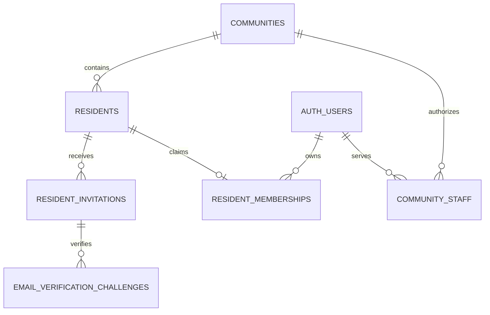

# Resident registration with FastAPI, Resend, and Supabase Auth

Archived multi-community alternative. The current single-community MVP proposal is [RESIDENT_REGISTRATION_MVP.md](RESIDENT_REGISTRATION_MVP.md), which reuses profiles and completes signup/sign-in in the OTP submission action. Do not apply both SQL drafts. This older proposal is retained for review if its tables have already been created.

Status: proposed database design. The SQL is not applied, and these signup routes are not implemented or deployed. Existing report routes currently verify JWTs and ownership; they do not yet enforce verified residency.

## Responsibility and proof

FastAPI generates and verifies six-digit email OTPs. Resend delivers the email through its API. Supabase Auth remains the account/password and session provider after successful registration. An OTP proves control of an email address; management's resident register and a matching invitation establish eligibility for a community.

Design assumption: management records or approves each person's individual email before issuing an email-bound invitation. If the existing register only contains names and units, collect/review the email first; this draft does not automatically approve a self-entered name or address. The manual-review path can create the approved record and invitation after that review.

Use [sql/002_resident_verification_draft.sql](../../sql/002_resident_verification_draft.sql) as an additive proposal for the project owner's review. Do not run it before reviewing existing table names, roles, grants, and onboarding requirements. It does not alter `auth.users`, `reports`, or their existing policies.

## Tables

| Table | Purpose and important fields |
| --- | --- |
| `auth.users` | Supabase-managed account UUID, email, password handling, and email confirmation. Do not add OTPs/passwords to application tables or write directly to this managed table. |
| `communities` | Community ID, name, and active/inactive status. |
| `community_staff` | Trusted management assignments: community ID, Auth user ID, role, status. Only trusted administrator operations assign these roles. |
| `residents` | Management's preapproved record for each person: ID, community ID, resident reference, name, unit, registered email, status. |
| `resident_invitations` | Resident-bound, email-bound invitation token digest, expiry, issuer, revocation, used timestamp, and consuming Auth user. |
| `email_verification_challenges` | OTP HMAC digest, target email/invitation/resident/community, expiry, attempts, send acceptance, verification, and registration completion state. |
| `resident_memberships` | Links one resident record to one Supabase account in a community. Stores verified/suspended status and verification method. |

`residents` has no account UUID until membership is completed. This makes it possible for management to create the register before anyone signs up.

## What to store for the OTP

| Column | Meaning |
| --- | --- |
| `id` | Random challenge UUID returned to the client; not an OTP and not proof of verification. |
| `invitation_id`, `resident_id`, `community_id` | Bind the challenge to the approved invitation and person. |
| `email`, `purpose` | Exact normalized target address and `resident_signup`; do not reuse this proof for password reset or email change. |
| `otp_digest` | 32-byte HMAC-SHA256 result. Never store the plaintext six-digit code. |
| `pepper_version` | Identifies the server-held HMAC key used to compute the digest; the key itself is not stored in the database. |
| `created_at`, `expires_at` | Server timestamps; proposed OTP lifetime is five minutes. |
| `attempt_count`, `max_attempts`, `last_attempt_at` | Enforce at most five failed checks per challenge. |
| `send_status`, `send_accepted_at`, `provider_message_id` | Track Resend's acceptance of the send request. Provider acceptance does not mean the email was received or the resident verified. |
| `revoked_at` | Invalidates an old or failed challenge. |
| `verified_at` | Successful OTP use; an already verified challenge cannot verify another OTP request. |
| `verification_token_digest`, `verification_expires_at` | Hash of a separate high-entropy, short-lived completion token returned after OTP verification. This authorizes finishing signup without reusing the OTP. |
| `signup_started_at`, `auth_user_id`, `completed_at` | Track external Auth provisioning and final membership completion so retries do not create another account. |

Generate a six-character string with `f"{secrets.randbelow(1_000_000):06d}"`; this preserves a leading zero. Keep it only in process memory long enough to send it to the intended email via Resend. Do not log it, return it from the request-OTP endpoint, or persist it in a plaintext email job/outbox.

Compute `HMAC-SHA256(server_pepper, canonical_context_and_otp)`. The canonical context includes challenge ID, invitation ID, resident ID, community ID, normalized email, purpose, and the six-digit string. Encode deterministically, for example as sorted compact JSON. Compare candidate digests with `hmac.compare_digest`. Ordinary unkeyed SHA256 is insufficient for a six-digit code: a database reader can try all one million possible values. Keep the pepper in the backend's secret configuration, separate from database rows and client code.

Invitation and verification-completion tokens use at least 32 cryptographically random bytes. Store only their SHA256 digest; show or deliver the original token only to its intended recipient. These high-entropy tokens are different from the six-digit OTP.

## Registration sequence

1. Management creates a community and one resident record per person, with a stable internal resident reference and an individual email address. A trusted manager issues an invitation tied to that record and email. The proposed invitation lifetime is seven days.
2. The resident enters an email and invitation. FastAPI validates the invitation, active community/resident, target email, expiry, and unused/unrevoked state. Treat name and unit from the register as authoritative for resident eligibility; user-entered name is not proof.
3. FastAPI applies rate limits, creates a fresh challenge, stores its HMAC digest, and sends the plaintext OTP in memory through Resend. Use the challenge ID as the provider idempotency key for retries of the same in-memory send. An accepted response records the message ID and acceptance timestamp. A failed send revokes the challenge; a later resend generates a new code and challenge.
4. The client sends the challenge ID and six-digit code. A database transaction locks the resident and challenge, checks send acceptance, expiry, revocation, attempt budget, target context, and unused state. A wrong code increments the counter and commits that increment; do not raise an exception that rolls it back. A match sets `verified_at` once and stores the digest/expiry of a new random completion token. Return that token once to the client over HTTPS.
5. The client submits the completion token and password to the proposed completion endpoint. FastAPI validates the token, its expiry, and the invitation/resident again, then reserves the registration attempt atomically. Passwords are passed to Supabase Auth and never stored in these application tables or request logs.
6. For a new account, a server-only Supabase Auth Admin operation creates the user with confirmed email only after the custom verification succeeds. Bind the registration challenge ID using trusted Auth `app_metadata` to help reconcile interrupted provisioning. For an existing account, require normal Supabase authentication, confirm its current verified email matches the challenge and resident record, and bind the verified session's UUID; do not attach an arbitrary account by matching an email address alone.
7. A final database transaction locks the resident, invitation, and challenge in a consistent order; inserts the membership; marks the invitation used by that UUID; and records challenge completion. Uniqueness guards prevent concurrent claims. If the database write fails after Auth creation, retain the provisioning state and reconcile the same attempt; do not create a second Auth user or accept any existing user found by email.
8. The resident signs in through the existing Supabase login flow and receives a Supabase JWT. Community features require a live verified membership in an active community for an active resident.

Supabase Auth and application-table writes are separate systems. Several Data API calls are not a database transaction. Use a reviewed SQL RPC or an actual PostgreSQL transaction for each atomic application transition, and use the stored provisioning state to recover between Auth and database operations.

## Duplicate-account and resend rules

- `UNIQUE(resident_id)` on memberships allows one account binding per resident record.
- `UNIQUE(community_id, user_id)` allows one resident record per account within that community; the same Auth account can legitimately belong to multiple communities.
- `UNIQUE(community_id, resident_reference)` prevents importing the same management reference twice. It does not prove two separately entered records are different physical people; management still needs to prevent duplicate records.
- Active registered emails are unique within a community. Each resident needs their own email for this email/password MVP. Normalize with trim/lowercase consistently; do not strip provider-specific dots or plus aliases.
- Unit numbers are not unique: several family members can register for the same unit through separate approved records.
- Issuing a replacement invitation revokes the previous open invitation and its unfinished challenges in one transaction. A used invitation cannot issue another membership.
- Resending generates a new OTP/challenge and invalidates the previous unfinished challenge. Do not reset an old challenge's attempts or issue a new challenge while account provisioning is in progress.
- Proposed limits: five-minute OTP expiry, five failed attempts per challenge, 60-second send cooldown, and at most three sends per address per 15 minutes. Also limit verification failures across resends and by IP using a shared server-side rate limiter; per-row attempt counters alone are insufficient.
- Forgot-password uses the existing account recovery flow. Account deletion/reassignment requires an explicit management procedure; the proposed foreign keys restrict deleting an account that still has resident or audit links.

## Proposed API contract (not active routes)

| Endpoint | Input | Result |
| --- | --- | --- |
| `POST /api/v1/registration/request-otp` | `email`, `invitation_token` | Generic acceptance plus `challenge_id`; never return the OTP. Invalid/unknown targets must not reveal resident-record details. |
| `POST /api/v1/registration/verify-otp` | `challenge_id`, six-character `otp` string | Short-lived verification completion token, or a generic invalid/expired response. |
| `POST /api/v1/registration/complete` | `challenge_id`, completion token, password; authenticated session when linking an existing account | Registration completion state; login remains Supabase Auth. Retry the same attempt instead of creating another account. |
| `GET /api/v1/me/residency` | Verified Supabase JWT | Own membership status/community/resident IDs. |

The public request endpoint must use a uniform response contract and timing for eligible/ineligible targets. Synthetic challenge IDs for rejected requests must never create an eligible row. Enforce rate limits before email delivery. An unverified caller cannot choose a database `user_id`, staff role, approval flag, or resident record.

## RLS and deployment prerequisites

The proposal enables RLS on every new table. Anonymous clients have no table privileges. Signed-in users can read their own membership/resident/staff records; active managers can read community resident/member records. Direct invitation/challenge access is denied even to ordinary authenticated clients. All writes are server-controlled; clients cannot self-assign membership or management roles.

The proposed service-role grants are limited to the new tables, but a Supabase service-role/secret credential is still privileged. Keep its client isolated from resident report requests, which must continue to use each resident's JWT. The existing publishable key cannot perform these privileged signup writes or Auth Admin operations. The project owner must configure the server's privileged access and trusted management bootstrap before implementation.

Custom OTP verification does not automatically confirm an account in Supabase Auth. Use the reviewed Auth Admin API after verification; do not edit managed Auth rows directly or let the client submit an `email_confirmed` flag. The owner must review existing signup/email-confirmation settings to avoid conflicting confirmation flows.

Add verified-membership checks to report APIs and database RLS before launching resident-only access. The current reports contract has no community ID, so multi-community report isolation needs a separate reviewed schema/policy change and legacy-data plan. Existing ownership policies do not already implement this new residency requirement.

Required server configuration will include `RESEND_API_KEY`, an approved sender address/domain, `OTP_HMAC_SECRET` and its key-version handling, and privileged Supabase Auth/database access. No values have been created or added to the live environment by this design task.

Retain only the challenge/audit data needed for delivery diagnostics and signup recovery; redact OTPs, hashes, completion tokens, passwords, and API keys from logs/responses. Expired unfinished challenges can be purged after a reviewed rate-limit/recovery retention window. Keep completed invitations/memberships or a redacted audit record long enough to preserve one-person/one-account controls.

## Validation required before implementation

The project owner should review and test the proposed DDL against the real schema. Application tests must cover leading-zero codes, wrong/expired codes, send failure, resend invalidation, attempt increments that survive failures, concurrent verification, repeated completion, cross-resident/community references, partial Auth provisioning recovery, account reuse requiring authentication, and denied direct challenge reads/writes. SQL syntax validation alone does not establish these runtime properties.

References: [Resend send API](https://resend.com/docs/api-reference/emails/send-email), [Supabase Auth Admin create user](https://supabase.com/docs/reference/python/auth-admin-createuser), [Supabase user-data guidance](https://supabase.com/docs/guides/auth/managing-user-data), [OWASP single-use token guidance](https://cheatsheetseries.owasp.org/cheatsheets/Forgot_Password_Cheat_Sheet.html), [Python HMAC](https://docs.python.org/3/library/hmac.html), [PostgreSQL constraints](https://www.postgresql.org/docs/current/ddl-constraints.html).
